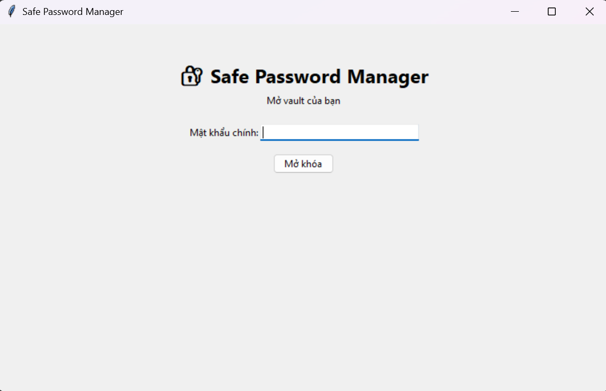
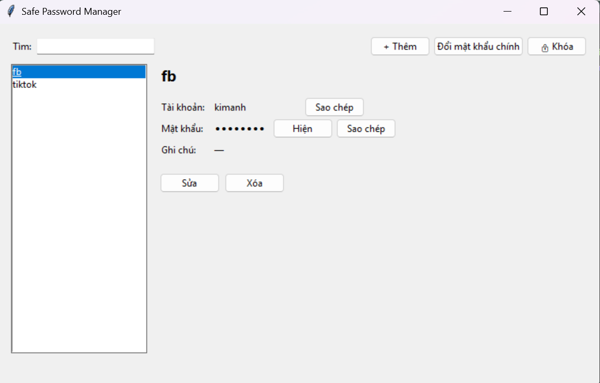
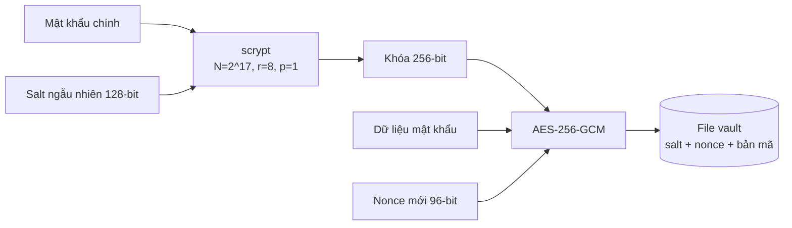

<div align="center">

# 🔐 Safe Password Manager

**Trình quản lý mật khẩu chạy trên máy tính, mã hóa toàn bộ dữ liệu bằng scrypt và AES-256-GCM.**


[English summary](#english-summary)

</div>

| Màn hình đăng nhập | Màn hình chính |
|---|---|
|  |  |

## Giới thiệu

Ứng dụng lưu tài khoản và mật khẩu của nhiều dịch vụ trong một file **vault** được mã hóa. Người dùng chỉ cần nhớ một **mật khẩu chính**. Mật khẩu chính không bao giờ được lưu lại dưới bất kỳ dạng nào.

Dự án được làm lại từ đồ án môn Lập trình Python năm 2 (2025), với thiết kế mật mã chuẩn, mô hình đe dọa và bộ kiểm thử bảo mật.

## Tính năng

- Tạo vault, thêm, sửa, xóa và tìm kiếm mục mật khẩu.
- Tạo mật khẩu ngẫu nhiên mạnh bằng module `secrets`.
- Mật khẩu hiển thị dạng `••••` cho tới khi người dùng bấm **Hiện**.
- Sao chép vào clipboard, **tự xóa sau 20 giây**.
- **Tự khóa sau 5 phút** không thao tác.
- **Sai mật khẩu chính 5 lần thì tạm khóa**, thời gian chờ tăng gấp đôi sau mỗi lần sai tiếp theo.
- Đổi mật khẩu chính (phải xác minh lại mật khẩu hiện tại).

## Cách hoạt động



| Thành phần | Lựa chọn | Lý do |
|---|---|---|
| Tạo khóa (KDF) | **scrypt** (N = 2¹⁷, r = 8, p = 1) theo khuyến nghị của OWASP | Cố tình chậm và tốn khoảng 128 MB RAM mỗi lần thử, khiến tấn công dò mật khẩu (brute force) bằng GPU rất tốn kém |
| Salt | 16 byte ngẫu nhiên, riêng cho mỗi vault | Hai người cùng mật khẩu vẫn ra hai khóa khác nhau, vô hiệu hóa bảng tra sẵn (rainbow table) |
| Mã hóa | **AES-256-GCM** | Vừa giấu nội dung vừa xác thực: sửa dù chỉ 1 bit cũng bị phát hiện |
| Nonce | 12 byte ngẫu nhiên, **tạo mới mỗi lần lưu** | Dùng lại nonce với cùng khóa sẽ phá vỡ AES-GCM |
| AAD | Phiên bản và tham số scrypt (gồm salt) | Phần đầu file không cần giấu nhưng phải chống sửa |
| Xác minh mật khẩu chính | Thử giải mã: sai mật khẩu thì AES-GCM báo lỗi | Không cần lưu hash của mật khẩu chính |
| Ghi file | Ghi ra file tạm, `fsync`, rồi thay thế | Mất điện giữa chừng không làm hỏng vault cũ |

Thư viện mã hóa dùng là [`cryptography`](https://cryptography.io/), được kiểm định rộng rãi. Dự án **không tự viết thuật toán mã hóa**.

## Cài đặt và chạy

Yêu cầu Python 3.9 trở lên.

```bash
git clone https://github.com/kimanhtran-oss/safe-password-manager.git
cd safe-password-manager
python -m venv .venv
.venv\Scripts\activate        # Windows (macOS/Linux: source .venv/bin/activate)
pip install -r requirements.txt

python main.py                 # chạy ứng dụng
python -m unittest discover tests -v   # chạy kiểm thử
```

Vault được lưu tại `~/.safe-password-manager/my.vault`, nằm ngoài thư mục mã nguồn.

> ⚠️ **Quên mật khẩu chính là mất toàn bộ dữ liệu.** Đây là chủ đích thiết kế: không có cửa hậu (backdoor) để khôi phục.

## Kiểm thử bảo mật

Mỗi tính chất bảo mật đều có kiểm thử chứng minh (`tests/test_vault.py`, 19 test):

| Tính chất | Kiểm thử |
|---|---|
| File vault không chứa bản rõ (tên dịch vụ, tài khoản, mật khẩu) | `test_file_khong_chua_ban_ro` |
| Sai mật khẩu chính bị từ chối | `test_sai_mat_khau_bi_tu_choi` |
| Phát hiện dữ liệu bị sửa (lật 1 bit) | `test_phat_hien_du_lieu_bi_sua` |
| Phát hiện phần đầu file bị sửa (AAD) | `test_phat_hien_salt_bi_sua` |
| Chặn file độc hại khai báo tham số scrypt khổng lồ (DoS) | `test_chan_tham_so_scrypt_qua_lon` |
| Nonce mới cho mỗi lần lưu | `test_nonce_moi_moi_lan_luu` |
| Đổi mật khẩu chính tạo salt mới, mật khẩu cũ hết hiệu lực | `test_doi_mat_khau_chinh` |
| Mật khẩu sinh ngẫu nhiên đủ loại ký tự, không trùng lặp | `TestTaoMatKhau` |

Quy trình CI trên GitHub Actions chạy kiểm thử, **pip-audit** (quét lỗ hổng thư viện) và **Bandit** (phân tích mã tĩnh) mỗi lần push. Ngoài ra repo bật **CodeQL**, **Dependabot** và **Secret scanning**.

## Cấu trúc thư mục

```
safe-password-manager/
├── .github/
│   ├── dependabot.yml
│   └── workflows/security.yml   # CI: test, pip-audit, Bandit
├── password_manager/
│   ├── vault.py                 # Lõi mã hóa: scrypt, AES-256-GCM, lưu file an toàn
│   └── app.py                   # Giao diện Tkinter
├── tests/
│   └── test_vault.py            # 19 kiểm thử bảo mật
├── images/                      # Ảnh chụp màn hình
├── main.py                      # Điểm chạy ứng dụng
├── SECURITY.md                  # Mô hình đe dọa và cách báo lỗ hổng
└── requirements.txt
```

## Giới hạn đã biết

- **Python không xóa hẳn được dữ liệu khỏi bộ nhớ.** Khi khóa, ứng dụng bỏ tham chiếu tới khóa và dữ liệu, nhưng bản sao có thể còn trong RAM cho tới khi bị ghi đè. Kẻ tấn công đã kiểm soát máy đang mở vault có thể đọc được.
- **Giới hạn số lần nhập sai chỉ có ở giao diện.** Kẻ đã lấy được file vault có thể thử mật khẩu ngoài ứng dụng. Lớp bảo vệ thật sự trong trường hợp đó là độ chậm của scrypt và độ mạnh của mật khẩu chính.
- **Clipboard của hệ điều hành** có thể bị phần mềm khác đọc trong 20 giây trước khi tự xóa. Lịch sử clipboard của Windows (Win + V) cũng có thể lưu lại.
- Không bảo vệ được trước phần mềm ghi phím (keylogger) trên máy đã bị nhiễm mã độc.

Chi tiết xem [SECURITY.md](SECURITY.md).

## English summary

A desktop password manager in **Python** with a **Tkinter** GUI. The vault is encrypted with **AES-256-GCM** using a key derived from the master password via **scrypt** (N=2¹⁷, r=8, p=1, per OWASP guidance) with a per-vault random salt. The master password is never stored: a wrong password simply fails GCM authentication. The file header (version, KDF parameters, salt) is bound as AAD, a fresh nonce is used on every save, KDF parameters are bounds-checked before use to prevent DoS, and writes are atomic.

The GUI adds masked display, clipboard auto-clear after 20 s, auto-lock after 5 minutes of inactivity, and an exponential lockout after 5 failed attempts. 19 unit tests verify each security property (tamper detection, no plaintext on disk, nonce uniqueness, and more). CI runs tests, pip-audit and Bandit. See [SECURITY.md](SECURITY.md) for the threat model and known limitations.

## Tác giả

**Trần Thị Kim Anh**, sinh viên Khoa học Máy tính, Đại học Công nghiệp TP.HCM (IUH). GitHub: [kimanhtran-oss](https://github.com/kimanhtran-oss)

## License

Phát hành theo giấy phép [MIT](LICENSE).
